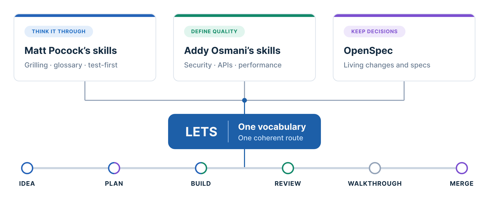
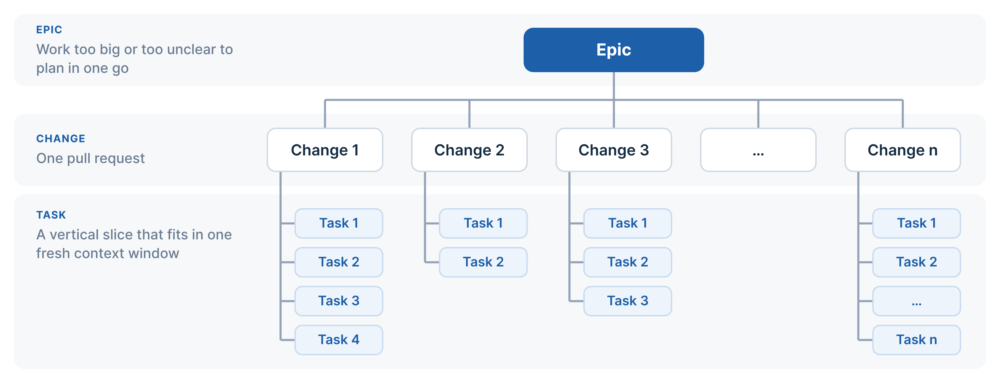

A complete workflow for [Claude Code](https://code.claude.com/docs) and [Codex](https://developers.openai.com/codex), combining [Matt Pocock's skills](https://github.com/mattpocock/skills), [Addy Osmani's agent skills](https://github.com/addyosmani/agent-skills) and [OpenSpec](https://github.com/Fission-AI/OpenSpec) under one coherent vocabulary.

<picture>
  <source media="(prefers-color-scheme: dark)" srcset="docs/images/statusline-dark.png">
  
</picture>

Enable the status line in Claude Code with `lets statusline on` to display the `epic`, the `change` and the `task` you're on.

## Why LETS exists

Working well with a coding agent takes three layers, and three popular projects each cover one:

- **Matt Pocock's skills** cover *how you think it through*: grilling a plan one question at a time, a shared glossary, test-first, and mapping out ambiguous work before it's planned in detail.
- **Addy Osmani's agent skills** cover *what good looks like*: security, performance, APIs, review.
- **OpenSpec** covers *what was decided*: changes and specs kept as files, so they outlast a chat.

**But they overlap:** They use different words for the same things, and don't work together out of the box; each has its own way to plan, review and route between skills, and they disagree on whether a spec is thrown away or kept.

**LETS** brings them together as one set of commands with one vocabulary, so each kind of work has one clear way through, from an idea to a merged pull request.

<picture>
  <source media="(prefers-color-scheme: dark)" srcset="docs/images/three-layers-dark.png">
  
</picture>

## Features

### Building

<picture>
  <source media="(prefers-color-scheme: dark)" srcset="docs/images/change-flow-dark.png">
   then /lets:review add-order-tracking. Then /lets:walkthrough, and you open a pull request. If changes are requested, /lets:change-revise add-order-tracking <comment> adds a task (clarify-status-labels), which is built and reviewed the same way. Otherwise /lets:change-close add-order-tracking, and you merge." src="docs/images/change-flow-light.png">
</picture>

- **Pair mode and agent mode**, chosen per repo, per pull request, or on the fly (`--pair`, `--agent`):
  - **Pair mode:** the agent walks you through the implementation in an order that's easy to follow, telling you exactly what to write and why it's done that way. You write it, and the agent checks it.
  - **Agent mode:** the agent handles implementation, explaining what it builds and why. For work you already understand, where speed matters more than practice.
- **Background builds** (`--agent --bg`): when a feature splits into several related but independent pieces, hand the straightforward ones to agents in the background, working in parallel, while you pair on the complex one.
- **Tasks as vertical slices** ([tracer bullets](https://pragprog.com/titles/tpp20/the-pragmatic-programmer-20th-anniversary-edition/)): each task is a small, end-to-end slice of functionality through every layer it touches. Integration problems show up in the first task rather than at the end, and each task fits in one fresh context window to minimise context degradation.
- **A final walkthrough before every pull request:** the agent explains the change in the order the code runs, then quizzes you on its decisions and risks, so you can explain and defend everything you ship.

### Planning and context

- **Defined routes for context:** every **LETS** command has defined inputs and outputs. It reads exactly what the previous step produced and writes exactly what the next one needs. Context is transported between sessions as plain files, not chat history, so nothing is lost and nothing irrelevant is loaded.
- **One route for each size of work:** a `patch` for a small fix, a `change` for one pull request, an `epic` for work too big or too unclear to plan in one go.

  <picture>
    <source media="(prefers-color-scheme: dark)" srcset="docs/images/hierarchy-dark.png">
    
  </picture>

  <picture>
    <source media="(prefers-color-scheme: dark)" srcset="docs/images/epic-flow-dark.png">
    
  </picture>

- **Choose where plans live** to match how your team works:
  - In the code repo, under `plans/`, committed alongside the code: when your team uses **LETS** and plans are reviewed in the same pull requests as the code.
  - In a shared planning repo: when your team reads and adds to the plans but keeps them separate from the code, whether working in a single repo or across several related repos.
  - In a private planning repo: when the plans are for you alone, so they stay out of your team's repositories.

  You can move plans between these locations later.
- **Respect a team that hasn't agreed to agents:** in its repos, agents leave the team's way of working alone: its AI instructions, its own docs and its GitLab or GitHub. You still get the whole workflow, and you commit and push as usual.
- **Learning detours:** `/lets:learn <concept>` teaches you a concept in a separate branch of your session, then `/resume` (Claude Code) brings you back to where you left off. Optionally, save what you've learned to a folder of your choice for future reference.

### Yours, for your whole career

- **Your profile:** build mode, test-first, questioning style, explanation length, where notes go and whether commits credit AI help, loaded in every session. Change any answer with `lets profile`.
- **Your additions:** your own rules for any command, described in your own words with `/lets:add`, which **LETS** never overwrites.
- **One folder of settings:** the same in every repo and on every computer. Keep it in git and it comes with you to every job.

## Install

You need Linux or macOS (on Windows, use WSL), Python 3.11 or newer, Node.js 20 or newer, git, and
[Claude Code](https://code.claude.com/docs) or [Codex](https://developers.openai.com/codex).

```bash
npm install -g @nasiq/lets
lets install
```

`lets install` asks how you like to work, shows every change it would make, and makes only the ones you agree to.

If you use Codex, open it once afterwards, type `/hooks` and trust **LETS**'s hooks: until you do, Codex won't run the guard.

## Quick start

In a repo you work in:

```bash
lets setup
```

It asks where this repo's plans live and how you build here. Then, in Claude Code (`/lets:…`) or Codex (`$lets:…`):

Every **LETS** command, such as `/lets:change-start`, `/lets:build` and `/lets:review`, works without arguments: run it on its own and the agent guides you through the details, asking questions as needed. Or give the arguments up front to be explicit:

| Command | What it does |
|---|---|
| `/lets:change-start` `add-order-tracking` | Plan one pull request |
| `/lets:build` `add-order-tracking` `show-order-status` | Build a task, pairing (or `--agent`) |
| `/lets:review` `add-order-tracking` | Review it |
| `/lets:walkthrough` `add-order-tracking` | Be walked through it, then get the PR description |
| `/lets:change-close` `add-order-tracking` | After approval: update the specs; then you merge |

Not sure what's next? `/lets:next` shows your open work and the next step. Questions about **LETS** itself: `/lets:help`.

## Read more

- [Tutorial: your first change](docs/tutorial.md), on your own repo
- [How-to guides](docs/how-to/): agent mode and background builds, small fixes, epics, stopping work, teams, several
  repos, moving plans, settings on two computers, your own additions, issues
- [Reference](docs/reference/): every command, `lets` itself, settings, the guard's rules, the profile
- [How LETS works, and why](docs/explanation.md)
- [Troubleshooting](docs/troubleshooting.md)

## What it touches, and what it sends

- `lets install` and `lets setup` show every change before making it, and back up what they edit. `lets uninstall`
  takes it all out again, putting back anything of yours it replaced.
- **LETS** never loosens Claude Code's or Codex's own permissions, with one exception: it lets them write to
  **LETS**'s own folders (your learning notes and planning repos).
- No telemetry. By default, **LETS** makes one network call: a once-a-day check of the
  [npm registry](https://www.npmjs.com/package/@nasiq/lets) for a newer version number. Turn it off with
  `lets profile updates`.
- It works in Claude Code and Codex on your own computer (`lets profile tools` picks which). Cloud sessions and other
  tools can read plans kept in a repo, but they can't run **LETS**'s commands or its guard.

## License

MIT. [Matt Pocock's skills](https://github.com/mattpocock/skills) and
[Addy Osmani's agent skills](https://github.com/addyosmani/agent-skills) are included under their own MIT licenses
(`plugin/LICENSES/`). [OpenSpec](https://github.com/Fission-AI/OpenSpec) is installed alongside as a dependency,
under its own MIT license.
